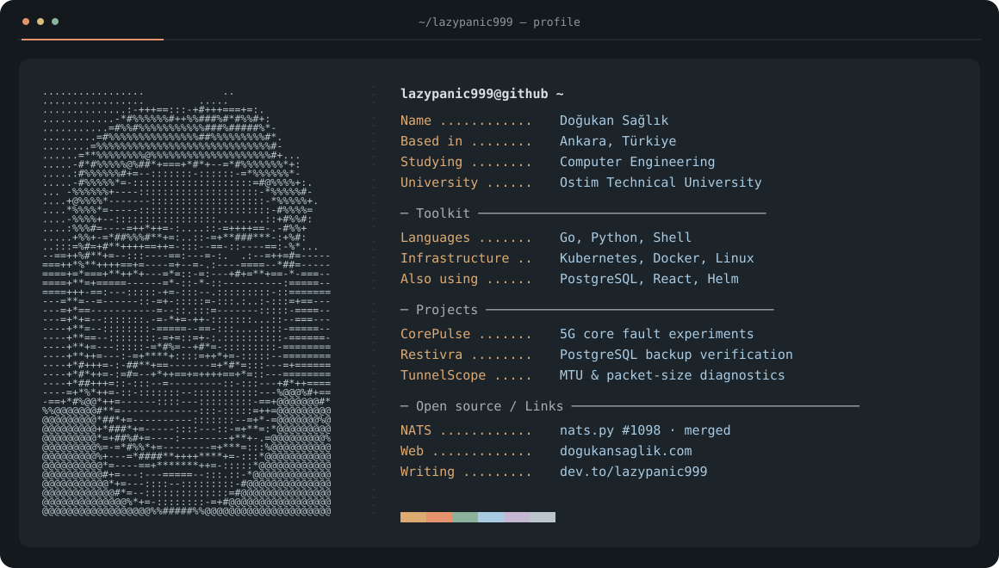

  

  <a href="https://dogukansaglik.com">Portfolio</a> &nbsp;·&nbsp;
  <a href="https://github.com/nats-io/nats.py/pull/1098">NATS contribution</a> &nbsp;·&nbsp;
  <a href="https://dev.to/lazypanic999">Writing</a>

I'm **Doğukan**, a Computer Engineering student at **Ostim Technical University** in Ankara, Türkiye. I build tools for investigating network behavior, testing infrastructure recovery, and verifying database backups.

Most of my current work uses **Go and Python**, with **Kubernetes, Linux, and Docker** underneath. I like projects where I can run an experiment, inspect what happened, and turn the results into a useful tool.

## Selected projects

| Project | What I'm building | Technologies |
| :--- | :--- | :--- |
| **[CorePulse](https://github.com/lazypanic999/CorePulse)** | A 5G core fault lab that records pod recovery and packet-path recovery separately, with telemetry collection and offline ML experiments. | Go · Python · Kubernetes |
| **[Restivra](https://github.com/lazypanic999/restivra)** | Self-hosted PostgreSQL backup verification through isolated restores, SQL checks, scheduled runs, and a history of results. | Go · React · PostgreSQL · Docker |
| **[TunnelScope](https://github.com/lazypanic999/tunnelscope)** | Packet-size and MTU diagnostics with paired sender/receiver observations and offline HTML reports. | Python · Linux · Networking |
| **[5G Kubernetes Lab](https://github.com/lazypanic999/open5gs-ueransim-kubernetes)** | A reproducible Open5GS + UERANSIM setup with deployment scripts, verification steps, and troubleshooting notes. | Kubernetes · Helm · Shell |

### A look at CorePulse

The lab tracks workload readiness alongside actual packet reachability. The project is in early development; offline model experiments are separate from live service checks.

## Open source

[NATS Python client · PR #1098](https://github.com/nats-io/nats.py/pull/1098) — preserved stream alternate location metadata across both JetStream APIs and added regression tests. Reviewed and merged on November 14, 2026.

## Tools I use

  
  
  
  
  
  
  

## Writing

- [Building CorePulse: a guarded 5G core fault lab in Go](https://dev.to/lazypanic999/building-corepulse-a-guarded-5g-core-fault-lab-in-go-4bpf)
- [A ready 5G pod can still drop packets](https://dev.to/lazypanic999/a-ready-5g-pod-can-still-drop-packets-corepulse-needs-contributors-30f2)
